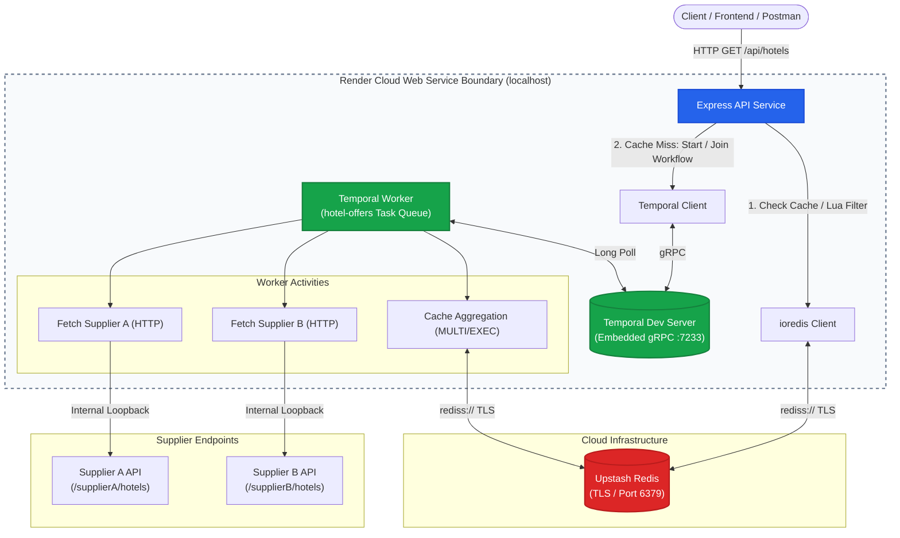
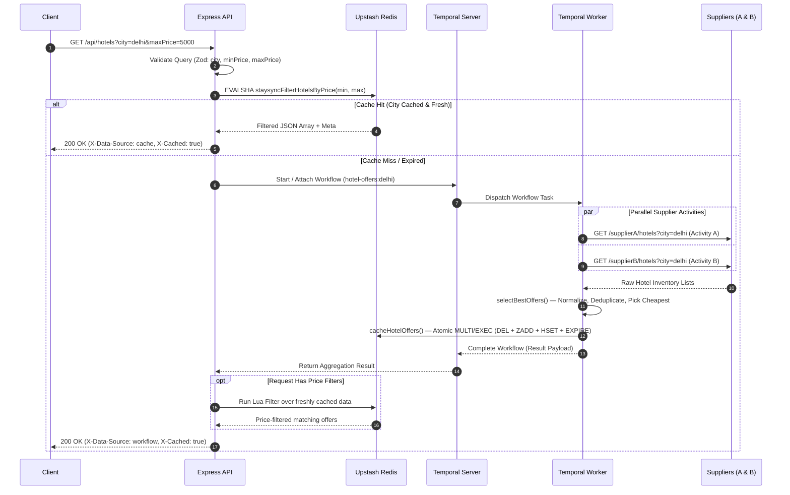

# StaySync — Hotel Offer Orchestrator

[](https://staysync-ad96.onrender.com)
[](https://github.com/KalidasMarndi/StaySync)

[](https://www.typescriptlang.org/)
[](https://nodejs.org/)
[](https://expressjs.com/)
[](https://temporal.io/)
[](https://upstash.com/)
[](https://www.docker.com/)
[](https://vitest.dev/)

> **Distributed Hotel Offer Orchestration Platform** that fans out concurrent queries across multiple upstream suppliers, deterministically deduplicates inventory, selects optimal pricing, and serves price-filtered results from an in-memory Redis cache with atomic Lua evaluation.

🔗 **Production Deployment**: [https://staysync-ad96.onrender.com](https://staysync-ad96.onrender.com)  
_(Note: Hosted on Render's free tier. If the instance is sleeping, initial wake-up takes ~45–60 seconds)._

---

## Table of Contents

- [Problem Statement](#problem-statement)
- [Key Features](#key-features)
- [System Architecture](#system-architecture)
- [Request Lifecycle](#request-lifecycle)
- [Temporal Workflow Orchestration](#temporal-workflow-orchestration)
- [Redis Caching & Lua Filtering](#redis-caching--lua-filtering)
- [API Reference](#api-reference)
- [Technology Stack](#technology-stack)
- [Deployment Architecture](#deployment-architecture)
- [Getting Started](#getting-started)
- [Testing & Quality Assurance](#testing--quality-assurance)
- [Project Structure](#project-structure)
- [Future Improvements](#future-improvements)
- [License & Acknowledgments](#license--acknowledgments)

---

## Problem Statement

Online travel agencies (OTAs) aggregate real-time hotel rooms from multiple wholesale suppliers. This introduces key distributed systems challenges:

1. **Overlapping Inventory**: Multiple suppliers list the same physical hotel under varying room rates, commissions, and slight naming inconsistencies (e.g., `"Holtin"` vs `" HOLTIN "`).
2. **Supplier Latency & Volatility**: Third-party supplier APIs suffer from unpredictable network latency, partial outages, and transient HTTP 5xx errors.
3. **Price Discrepancy & Tie-Breaking**: The platform must guarantee customers receive the lowest available rate, with deterministic tie-breaking when prices match.
4. **Redundant Upstream Workload**: Uncached requests can cause cascading downstream calls, escalating supplier API quotas and inflating server egress costs.

**StaySync** solves this by pairing **Temporal** (durable, fault-tolerant workflow orchestration with per-activity retries and partial outage tolerance) with **Redis** (atomic cache storage using Sorted Sets and embedded Lua scripts for server-side price filtering).

---

## Key Features

- **Concurrent Supplier Fan-Out**: Dispatches asynchronous requests to Supplier A and Supplier B concurrently via Temporal activities using `Promise.allSettled`.
- **Fault-Tolerant Partial Degradation**: If one supplier experiences an outage or times out, the workflow isolates the failure, aggregates available inventory from healthy suppliers, and marks the payload with `X-Degraded: true`.
- **Deterministic Deduplication & Price Selection**: Normalizes whitespace and casing, evaluates candidate offers, and retains the single cheapest offer per hotel. Deterministic tie-breaker rules assign priority to Supplier A on exact price ties.
- **Cache-First Architecture with In-Redis Filtering**: Pre-computes and caches aggregated inventory in Redis using **Sorted Sets** (`score = price`) and **Hashes**. Price-range filters (`minPrice`, `maxPrice`) are executed entirely inside Redis via an atomic Lua script (`ZRANGE BYSCORE` + `HMGET`), avoiding JavaScript array allocations.
- **Request Coalescing**: Workflows are keyed by `hotel-offers:<city>` with `workflowIdConflictPolicy: USE_EXISTING`. Concurrent uncached requests for the same city attach to a single running execution rather than initiating duplicate upstream calls.
- **Upstash Redis over TLS**: Fully compatible with cloud-managed Redis providers requiring TLS connections and Redis ACL username authentication (`AUTH default <token>`).
- **Deep Health Probes**: `/health` checks every dependency concurrently (Redis `PING`, Temporal gRPC health, Worker poller freshness `<90s`, and live supplier HTTP ping queries).
- **Dual Deployment Support**: Native multi-container setup via Docker Compose for local development, and an integrated supervisor architecture for zero-cost cloud hosting on Render.

---

## System Architecture



---

## Request Lifecycle



---

## Temporal Workflow Orchestration

The core aggregation is managed by `hotelOfferWorkflow` (`src/workflows/hotel.workflow.ts`), executed in Temporal's deterministic sandbox:

1. **Parallel Activity Dispatch**: Schedules `fetchSupplierAHotels` and `fetchSupplierBHotels` concurrently using `Promise.allSettled`.
2. **Fault Isolation**: If a supplier fails (network timeout, 5xx, or invalid schema), it is marked as `failed`. If at least one supplier succeeds, the workflow completes with `degraded: true`. If **both** fail, it raises a non-retryable `ApplicationFailure` (`AllSuppliersUnavailable`), prompting the API to return `502 Bad Gateway`.
3. **Pure Deduplication Function**: Invokes `selectBestOffers()`:
   - **Key Normalization**: `name.trim().replace(/\s+/g, ' ').toLowerCase()`.
   - **Cheapest Offer Selection**: Sorts candidates by `price ASC`.
   - **Deterministic Tie-Breaking**: If prices are identical, Supplier A takes priority.
4. **Best-Effort Caching**: Invokes the `cacheHotelOffers` activity. If Redis write fails after 3 retries, the workflow gracefully returns the aggregated offers with `cached: false` rather than failing the client request.

### Activity Retry Policies

| Activity                | Start-To-Close           | Schedule-To-Close | Max Attempts | Backoff Interval                | Non-Retryable Errors                  |
| ----------------------- | ------------------------ | ----------------- | ------------ | ------------------------------- | ------------------------------------- |
| **Supplier Activities** | `5s` (HTTP timeout `3s`) | `15s`             | 3            | 500ms (coefficient 2.0, max 5s) | HTTP 4xx, invalid JSON, broken schema |
| **Cache Activity**      | `5s`                     | `10s`             | 3            | 300ms (coefficient 2.0, max 2s) | Invalid payload schema                |

Workflow timeout is capped at **30 seconds**.

---

## Redis Caching & Lua Filtering

StaySync uses a 3-key cache architecture per normalized city, updated atomically in a single `MULTI/EXEC` transaction:

| Key Pattern                   | Data Structure | Purpose                                                                                |
| ----------------------------- | -------------- | -------------------------------------------------------------------------------------- |
| `staysync:hotels:{city}`      | **Sorted Set** | Member = normalized hotel name; **Score = price**. Used for `ZRANGE BYSCORE`.          |
| `staysync:hotels:{city}:data` | **Hash**       | Field = normalized hotel name; **Value = full JSON offer payload**.                    |
| `staysync:hotels:{city}:meta` | **String**     | JSON metadata (`city`, `count`, `degraded`, `refreshedAt`, `ttlSeconds`, `suppliers`). |

### Atomic Lua Script (`staysyncFilterHotelsByPrice`)

Price filtering executes entirely inside Redis via Lua ([src/services/redis-scripts.ts](src/services/redis-scripts.ts)):

1. Checks for the existence and validity of the `:meta` key.
2. Validates that `ZCARD` of the Sorted Set matches `meta.count` (detects desynchronization).
3. Executes `ZRANGE staysync:hotels:{city} min max BYSCORE`.
4. Retrieves corresponding offer JSONs from the Hash using `HMGET` in batches of 500 to protect the Lua call stack.
5. Returns `{ metaJson, offerJson1, ... }` ordered by price ascending.

### TTL Configuration

- **Standard TTL**: `300 seconds` (5 minutes) for complete multi-supplier results.
- **Degraded TTL**: `30 seconds` for partial results when a supplier fails.

---

## API Reference

Comprehensive endpoint documentation is available in [API.md](API.md).

### 1. Search Hotels

```http
GET /api/hotels?city={city}&minPrice={min}&maxPrice={max}
```

#### Example Request

```bash
curl -i "https://staysync-ad96.onrender.com/api/hotels?city=delhi&minPrice=4000&maxPrice=7000"
```

#### Example Response (200 OK)

```http
HTTP/2 200
content-type: application/json; charset=utf-8
x-city: delhi
x-data-source: cache
x-cached: true
x-degraded: false
x-result-count: 4

[
  { "name": "Lemon Tree", "price": 4200, "supplier": "Supplier A", "commissionPct": 8 },
  { "name": "Ibis New Delhi", "price": 4800, "supplier": "Supplier B", "commissionPct": 12 },
  { "name": "Holtin", "price": 5340, "supplier": "Supplier B", "commissionPct": 20 },
  { "name": "Radison", "price": 5900, "supplier": "Supplier A", "commissionPct": 13 }
]
```

### 2. Comprehensive Health Check

```http
GET /health
```

Returns a structured JSON health report with latency metrics for all dependencies.

```json
{
  "status": "healthy",
  "ready": true,
  "timestamp": "2026-11-22T10:42:49.850Z",
  "uptimeSeconds": 15,
  "services": {
    "api": { "status": "healthy" },
    "redis": { "status": "healthy", "latencyMs": 64 },
    "temporal": { "status": "healthy", "latencyMs": 4 },
    "worker": {
      "status": "healthy",
      "latencyMs": 5,
      "details": { "activePollers": 1, "lastPollSecondsAgo": 26 }
    },
    "supplierA": { "status": "healthy", "latencyMs": 6 },
    "supplierB": { "status": "healthy", "latencyMs": 7 }
  }
}
```

### Additional Endpoints

| Method | Path                | Description                                                       |
| ------ | ------------------- | ----------------------------------------------------------------- |
| `GET`  | `/`                 | Root service info (name, status, deployment, docs, key endpoints) |
| `GET`  | `/health/live`      | Lightweight liveness probe (200 OK if event loop is alive)        |
| `GET`  | `/health/ready`     | Readiness probe (200 if Redis OR Temporal+Worker are operational) |
| `GET`  | `/supplierA/hotels` | Mock upstream Supplier A inventory endpoint                       |
| `GET`  | `/supplierB/hotels` | Mock upstream Supplier B inventory endpoint                       |

---

## Technology Stack

| Technology       | Version       | Purpose in StaySync                                                     |
| ---------------- | ------------- | ----------------------------------------------------------------------- |
| **TypeScript**   | `5.x`         | Strict compile-time type safety across domain, workflow, and API layers |
| **Node.js**      | `24.x LTS`    | Asynchronous JavaScript runtime environment                             |
| **Express**      | `5.x`         | High-performance HTTP server and middleware routing                     |
| **Temporal SDK** | `1.25.0`      | Durable workflow state machines, retries, and determinism management    |
| **Redis**        | `7.4`         | In-memory Sorted Sets for price index and Hash storage                  |
| **ioredis**      | `5.11.x`      | Redis client with TLS and custom Lua command definitions                |
| **Zod**          | `4.x`         | Runtime schema validation for query strings and environment variables   |
| **Pino**         | `10.x`        | Structured JSON logger with contextual child loggers                    |
| **Docker**       | Multi-Stage   | Minimal, secure Debian-based production image (`node:24-bookworm-slim`) |
| **Render**       | Cloud Hosting | Zero-cost web service hosting                                           |
| **Upstash**      | Cloud Redis   | Serverless Redis with encrypted TLS connections                         |

---

## Deployment Architecture

StaySync supports two distinct deployment modes without requiring code modifications:

### 1. Local Development (Multi-Container Docker Compose)

Used for local development and integration testing:

- **`api` container**: Runs `node dist/server.js`.
- **`worker` container**: Runs `node dist/temporal/worker.js`.
- **`temporal` container**: Runs official `temporalio/temporal:1.10.1` dev server.
- **`redis` container**: Runs `redis:7.4-alpine` with AOF persistence.

### 2. Render Demo Deployment (Combined Supervisor Architecture)

Engineered for zero-cost ($0) cloud demonstration on Render's Free Web Service:

- **Single Container**: Runs an embedded headless Temporal server, Temporal worker, and Express API managed by `scripts/start-combined.sh`.
- **Internal Loopback**: The Temporal worker and client communicate with the Temporal server via `127.0.0.1:7233` without incurring external network hops. Mock suppliers are resolved on loopback `http://127.0.0.1:${PORT}`.
- **External Cache**: Connects securely to an **Upstash Redis** instance over TLS (`rediss://`).
- **Memory Footprint**: Memory usage is tuned (`NODE_OPTIONS=--max-old-space-size=128`) to operate within Render's 512 MB RAM allowance (~420–480 MB RSS under load).

> [!NOTE]
> **Cloud Demo Limitations**:
>
> - **Inactivity Sleep**: Render's free tier spins down containers after 15 minutes of inactivity. The first request after a sleep period requires ~45–60s for cold-start initialization.
> - **Ephemeral Workflow History**: Embedded Temporal server storage is ephemeral (`/tmp/temporal.db`). Restarting the container clears workflow execution logs, though cached entries in Upstash persist.

---

## Getting Started

### Prerequisites

- **Node.js** `>= 22.12.0` (v24 LTS recommended)
- **npm** `>= 10`
- **Docker & Docker Compose v2** (optional, for containerized run)

### Local Setup with Docker Compose

```bash
# 1. Clone the repository
git clone https://github.com/KalidasMarndi/StaySync.git
cd StaySync

# 2. Build and launch all 4 containers
docker compose up --build -d

# 3. Verify container health
docker compose ps

# 4. Query the API
curl "http://localhost:4000/api/hotels?city=delhi"

# 5. Access Temporal Web UI
open http://localhost:8233
```

### Local Setup without Docker (Bare Metal)

```bash
# 1. Install dependencies
npm ci

# 2. Copy environment file
cp .env.example .env

# 3. Start local development dependencies (via helper scripts)
npm run redis:up
npm run temporal:up

# 4. Start the Express API (Terminal 1)
npm run dev

# 5. Start the Temporal Worker (Terminal 2)
npm run dev:worker
```

---

## Testing & Quality Assurance

StaySync adheres to strict verification standards across unit, workflow, and integration test suites:

```bash
# Run complete validation pipeline
npm run typecheck       # TypeScript compiler check (0 errors)
npm run lint            # ESLint static analysis (0 warnings)
npm run build           # Production TypeScript build
npm run test:unit       # 175 unit tests (pure domain logic & validation)
npm run test:workflow   # 21 workflow tests (deterministic replay & retries)
npm run smoke           # 13 end-to-end smoke tests against running server
```

### Test Suite Breakdown

| Suite              | Tests Passed | Infrastructure      | Focus Areas                                                                             |
| ------------------ | ------------ | ------------------- | --------------------------------------------------------------------------------------- |
| **Unit Tests**     | **175**      | In-Memory           | Name normalization, sorting, tie-breaking, Zod validation, error mapping, health checks |
| **Workflow Tests** | **21**       | Temporal TestServer | Parallel activity dispatch, partial failure degradation, determinism replay tests       |
| **Smoke Tests**    | **13**       | Running Stack       | Full request-response cycle, cache hit/miss transitions, Redis price bounds             |

---

## Project Structure

```text
StaySync/
├── src/
│   ├── server.ts               # HTTP server bootstrap & graceful shutdown logic
│   ├── app.ts                  # Express application factory & middleware chain
│   ├── activities/             # Temporal activity implementations (HTTP & Cache)
│   ├── config/                 # Environment validation (Zod) & ioredis client factory
│   ├── controllers/            # Express route controllers (Hotels, Health, Dev)
│   ├── domain/                 # Pure domain business logic (deduplication & sorting)
│   ├── middleware/             # Error handling, request logging, 404 middleware
│   ├── mock-suppliers/         # Mock inventory data & supplier endpoints
│   ├── routes/                 # Express router definitions
│   ├── services/               # Hotel search orchestration, Redis cache, health service
│   ├── temporal/               # Temporal client, worker runtime, bundle script
│   ├── types/                  # Shared TypeScript interfaces & types
│   ├── validation/             # Zod query & payload validation schemas
│   └── workflows/              # hotelOfferWorkflow implementation
├── tests/
│   ├── unit/                   # Unit test suites (175 tests)
│   ├── workflow/               # Temporal workflow integration tests (21 tests)
│   ├── integration/            # Full system integration tests
│   └── helpers/                # Test fixtures & Redis mock helpers
├── scripts/
│   ├── smoke-test.mjs          # End-to-end smoke verification script
│   └── start-combined.sh       # Multi-process production supervisor for Render
├── docs/                       # Technical assignment checklist & design references
├── postman/                    # Postman collection with automated test assertions
├── API.md                      # Comprehensive API reference documentation
├── SYSTEM_DESIGN.md            # In-depth architectural & distributed systems guide
├── Dockerfile                  # Multi-stage production container definition
├── docker-compose.yml          # Multi-container local development stack
└── package.json                # Project dependencies & npm scripts
```

---

## Future Improvements

- [ ] **Production Temporal Cluster**: Transition from embedded development server to a distributed Temporal Cloud or Kubernetes-backed Temporal cluster.
- [ ] **Persistent Workflow State**: Back Temporal with persistent AWS RDS PostgreSQL or managed Aurora instead of ephemeral SQLite.
- [ ] **Independent Horizontal Scaling**: Separate the API and Worker into independently autoscaling Kubernetes Deployments or AWS ECS Tasks.
- [ ] **Real Supplier Integrations**: Replace mock supplier modules with live Amadeus / Sabre / Booking.com OTA partner APIs.
- [ ] **Authentication & Rate Limiting**: Implement API Key or OAuth2 authentication and Redis token-bucket rate limiting on `/api/*`.
- [ ] **Distributed Observability**: Integrate OpenTelemetry SDK for distributed tracing across Express, Temporal, and Redis spans.

---

## License & Acknowledgments

- **License**: Unlicensed / Proprietary (Personal Engineering Portfolio & Technical Assignment Project).
- Built with [Temporal](https://temporal.io), [Node.js](https://nodejs.org), and [Redis](https://redis.io).
