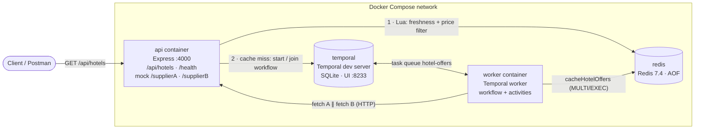
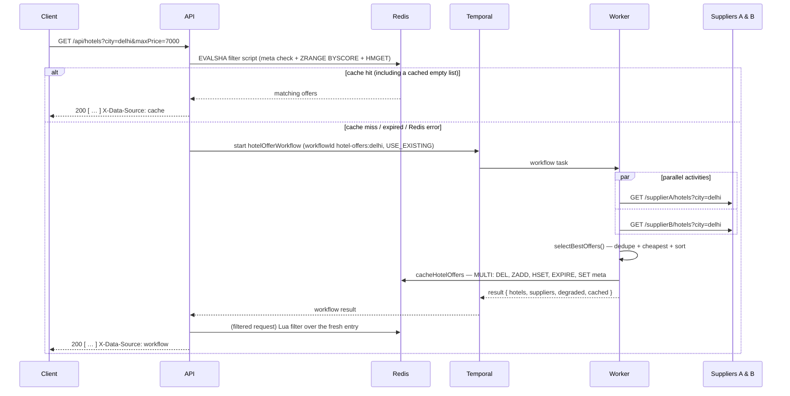
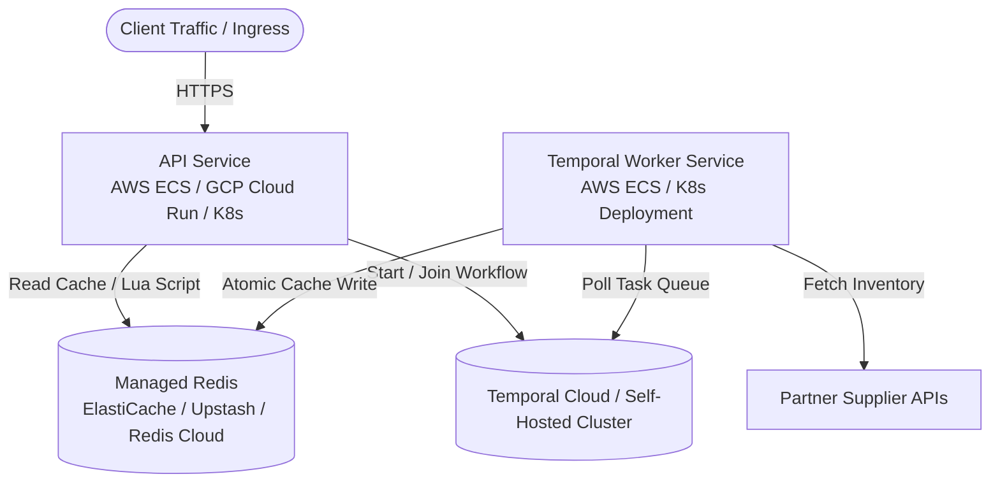

# Stay-Sync — Hotel Offer Orchestrator

Stay-Sync aggregates hotel offers from two suppliers, removes duplicate hotels, keeps the
cheapest offer for each one, and serves the result — optionally filtered by price — from
Redis. The supplier fan-out is orchestrated by a **Temporal** workflow.

Built with **Node.js + TypeScript, Express, Temporal, Redis and Docker Compose**.

> This is a technical-assignment project: complete, tested and runnable with one command,
> but deliberately scoped (single Temporal dev server, mock suppliers). See
> [Known limitations](#known-limitations).

---

## Contents

- [Problem statement](#problem-statement)
- [Quick start](#quick-start)
- [Architecture](#architecture)
- [How it works](#how-it-works)
  - [Temporal orchestration](#temporal-orchestration)
  - [Deduplication and cheapest offer](#deduplication-and-cheapest-offer)
  - [Redis data design](#redis-data-design)
  - [Cache-first API](#cache-first-api)
  - [Health checks](#health-checks)
  - [Failure handling](#failure-handling)
- [API reference](#api-reference)
- [Docker](#docker)
- [Cloud deployment readiness](#cloud-deployment-readiness)
- [Configuration](#configuration)
- [Local development without Docker](#local-development-without-docker)
- [Testing](#testing)
- [Postman collection](#postman-collection)
- [Project structure](#project-structure)
- [Known limitations](#known-limitations)

Requirement-by-requirement status: [docs/assignment-checklist.md](docs/assignment-checklist.md).

---

## Problem statement

Two suppliers return overlapping hotel lists for a city with different prices and
commissions. The service must:

1. Call **Supplier A and Supplier B in parallel**, orchestrated by **Temporal**.
2. **Deduplicate hotels by name** and keep the **cheaper** offer for hotels both suppliers
   sell; keep hotels only one supplier sells.
3. Return the de-duplicated list, **save it in Redis**, and support **price-range filtering
   performed inside Redis**.

Response format (`GET /api/hotels?city=delhi`):

```json
[
  { "name": "Holtin", "price": 5340, "supplier": "Supplier B", "commissionPct": 20 },
  { "name": "Radison", "price": 5900, "supplier": "Supplier A", "commissionPct": 13 }
]
```

---

## Quick start

### Requirements

| Software                   | Needed for                                                                 | Version                                                      |
| -------------------------- | -------------------------------------------------------------------------- | ------------------------------------------------------------ |
| Docker + Docker Compose v2 | running the whole system                                                   | any recent release (tested: Docker Engine 29.5, Compose 5.8) |
| Node.js + npm              | smoke test, test suite, local development (not needed to _run_ the system) | Node ≥ 22.12 (tested 24 and 26), npm ≥ 10 (tested 11.19)     |
| Free host ports            |                                                                            | **4000** (API), **8233** (Temporal Web UI)                   |

Internet access is needed the first time (Docker images, npm packages).

### Run it

```bash
# 1. Start everything (API, worker, Temporal, Redis). First build takes ~1 minute.
docker compose up --build -d

# 2. Wait until all four containers are healthy/running
docker compose ps

# 3. Try it
curl "http://localhost:4000/api/hotels?city=delhi"                              # first call: via Temporal
curl -i "http://localhost:4000/api/hotels?city=delhi"                           # second call: X-Data-Source: cache
curl "http://localhost:4000/api/hotels?city=delhi&minPrice=4000&maxPrice=7000"  # price filter (in Redis)
curl "http://localhost:4000/supplierA/hotels"                                   # raw supplier data
curl "http://localhost:4000/health"                                             # dependency health

# 4. Optional: automated end-to-end check (needs Node.js)
npm ci
npm run smoke                     # 13 checks against http://localhost:4000

# 5. Stop
docker compose down               # stop and remove containers (data volumes kept)
docker compose down -v            # …and delete Redis/Temporal data
```

Logs: `docker compose logs -f api worker`. Temporal Web UI: <http://localhost:8233> — every
aggregation appears as a `hotel-offers:<city>` workflow.

---

## Architecture



| Component                                      | Responsibility                                                                                                                                |
| ---------------------------------------------- | --------------------------------------------------------------------------------------------------------------------------------------------- |
| **Express API** (`src/server.ts`)              | Validates requests, reads Redis (cache-first), starts/joins workflows on a miss, health endpoints. Also hosts the two **mock supplier** APIs. |
| **Temporal worker** (`src/temporal/worker.ts`) | Runs `hotelOfferWorkflow` in Temporal's deterministic sandbox and the activities (supplier HTTP calls, Redis write).                          |
| **Temporal server**                            | Durable orchestration: schedules activities, retries them, records every run.                                                                 |
| **Redis**                                      | Stores the de-duplicated offers per city and performs price filtering (Lua).                                                                  |

Why Temporal: the fan-out is multi-step and failure-prone (timeouts, retries, partial
failure); Temporal gives per-activity retry policies, timeouts and a full execution history.
Why Redis: a sorted set answers price-range queries natively, and TTLs give cheap freshness.

### Request lifecycle



---

## How it works

### Temporal orchestration

`hotelOfferWorkflow` (`src/workflows/hotel.workflow.ts`):

1. Schedules `fetchSupplierAHotels` and `fetchSupplierBHotels` **before awaiting either**
   and waits with `Promise.allSettled` → the two HTTP calls run **in parallel**, and one
   supplier failing cannot discard the other's data.
2. Marks a supplier as failed if its activity fails after retries (or returns data that
   breaks the business rules).
3. **Both failed** → throws a non-retryable `ApplicationFailure` (`AllSuppliersUnavailable`)
   → the API answers **502**.
4. Otherwise calls the shared pure function `selectBestOffers()` and then the
   `cacheHotelOffers` activity. Caching is best-effort: if it fails after retries the result
   is still returned with `cached: false`.
5. Returns `{ city, hotels, suppliers, degraded, duplicatesResolved, cached }`.

Determinism: the workflow imports only pure modules (domain logic, constants, types); all I/O
(HTTP, Redis) happens in activities. A test replays a recorded history to prove it.

Activity policies (`src/temporal/constants.ts`):

|                                         | Supplier activities                           | Cache activity              |
| --------------------------------------- | --------------------------------------------- | --------------------------- |
| Per attempt (`startToCloseTimeout`)     | 5 s (HTTP timeout 3 s)                        | 5 s                         |
| All attempts (`scheduleToCloseTimeout`) | 15 s                                          | 10 s                        |
| Retries                                 | 3 attempts, 500 ms → 1 s backoff              | 3 attempts, 300 ms → 600 ms |
| Not retried                             | HTTP 400 / other 4xx, invalid JSON or payload | invalid payload             |

Retried: HTTP 503/5xx, timeouts, connection errors. A workflow run is capped at **30 s**.

**Concurrent requests**: the workflow ID is `hotel-offers:<city>` with
`workflowIdConflictPolicy: USE_EXISTING` — simultaneous requests for an uncached city join
**one** running workflow instead of starting duplicates (verified: 8 parallel requests → 1
workflow, 2 supplier calls).

### Deduplication and cheapest offer

`selectBestOffers()` in `src/domain/hotel-aggregation.ts` — pure, deterministic, unit-tested:

- **Match key**: name trimmed, internal whitespace collapsed, lower-cased —
  `" HOLTIN "` = `"Holtin"`, but `"Hol tin"` ≠ `"Holtin"`.
- **Winner**: lowest price. **Equal price → Supplier A wins.** (Repeated entries from one
  supplier at the same price are ordered by hotelId, so input order never changes the result.)
- `name` (whitespace cleaned, casing kept), `price`, `supplier` and `commissionPct` all come
  from the **same** winning offer — fields are never mixed.
- Hotels offered by only one supplier are always kept.
- **Sorted** by price ascending, then by name.
- Invalid offers (price ≤ 0 / NaN / Infinity, commission outside 0–100, blank name) are
  rejected, never silently accepted.
- `duplicatesResolved` = offers received − hotels returned (Delhi: 16 → 11 = **5**).

Delhi result: Holtin → Supplier B 5340 · Radison → Supplier A 5900 · Taj Palace → Supplier B
11800 · The Oberoi → Supplier A 15000 · Lemon Tree (4200 at both) → Supplier A.

### Redis data design

Three keys per normalized city, always written together with the **same TTL**:

| Key                           | Type       | Content                                                         |
| ----------------------------- | ---------- | --------------------------------------------------------------- |
| `staysync:hotels:{city}`      | Sorted set | member = normalized hotel name, **score = price**               |
| `staysync:hotels:{city}:data` | Hash       | field = normalized name, value = offer JSON                     |
| `staysync:hotels:{city}:meta` | String     | `{ city, count, degraded, refreshedAt, ttlSeconds, suppliers }` |

The `meta` key exists because Redis deletes empty sorted sets/hashes: without it a city with
**no hotels** would look like a cache miss forever. Its presence means "cached and fresh".

**Lua price filtering** (`src/services/redis-scripts.ts`) — one atomic `EVALSHA`:

1. `GET meta` → missing = miss.
2. `ZCARD` must equal `meta.count` → otherwise treat as a miss (out-of-sync keys).
3. `ZRANGE key min max BYSCORE` (inclusive; `-inf` / `+inf` for open bounds; needs Redis ≥ 6.2).
4. `HMGET` the matching offers (in batches) and return them in price order.

Node.js never filters prices.

**Atomic refresh** (`saveHotels` in `src/services/redis.service.ts`): one `MULTI/EXEC` —
`DEL` old keys → `ZADD` + `HSET` → `EXPIRE` both → `SET meta EX`. Readers see the old or the
new dataset, never a mix, and stale hotels never survive a refresh. Because Redis does not
roll back a command that fails inside `MULTI`, every offer is **validated before** anything
is sent.

**TTL**: **300 s** for a full result, **30 s** for a degraded one (one supplier failed) —
`CACHE_TTL_SECONDS` / `DEGRADED_CACHE_TTL_SECONDS`. All three keys expire at the same instant.

**Connection safety** (`src/config/redis.ts`): commands fail immediately while disconnected
and are never re-sent after reconnecting (`enableOfflineQueue: false`,
`autoResendUnfulfilledCommands: false`) — so a cache write reported as failed can never land
later over newer data. ioredis reconnects in the background with capped backoff.

### Cache-first API

`HotelService.searchHotels()` (`src/services/hotel.service.ts`):

1. **One Redis call** — the Lua script checks freshness and applies the price filter.
   **Hit** (including a cached empty list) → respond; no workflow, no supplier calls.
2. **Miss** (never cached, expired, inconsistent) **or Redis read error** → run/join the workflow.
3. Unfiltered → return the workflow's hotels. Filtered → run the Lua filter over the entry the
   workflow just cached; if it could not be cached (Redis down) → **503** rather than
   filtering in JavaScript.

### Health checks

| Endpoint            | Checks                                                                                                                                   | Status codes                         |
| ------------------- | ---------------------------------------------------------------------------------------------------------------------------------------- | ------------------------------------ |
| `GET /health/live`  | Nothing external — the process answers                                                                                                   | always 200                           |
| `GET /health/ready` | Redis up **or** (Temporal up **and** a live worker)                                                                                      | 200 / 503                            |
| `GET /health`       | api, redis (`PING`), temporal (gRPC health), worker (recent pollers on the task queue), supplierA, supplierB (real endpoint, probe city) | 200 healthy/degraded · 503 unhealthy |

Each probe runs in parallel with a **2 s** timeout; reports are reused for 2 s. **unhealthy**
= not ready, or both suppliers down; **degraded** = something down but still serving. The
worker is reported **unknown** when Temporal is unreachable (never assumed healthy), and a
worker counts as live only if it polled within the last **90 s**. Health checks never start
workflows or modify cached data (tested).

### Failure handling

| Situation           | Behaviour                                                                                                                                                                                                                                                              |
| ------------------- | ---------------------------------------------------------------------------------------------------------------------------------------------------------------------------------------------------------------------------------------------------------------------- |
| One supplier down   | Retried 3×; the other supplier's hotels are returned — `X-Degraded: true`, `X-Failed-Suppliers`, cached for 30 s                                                                                                                                                       |
| Both suppliers down | **502** `SUPPLIERS_UNAVAILABLE` (nothing is cached; the previous cache survives)                                                                                                                                                                                       |
| Redis down          | Unfiltered: served via the workflow (`X-Cached: false`). Filtered: **503**. Liveness stays 200; reconnects automatically                                                                                                                                               |
| Redis write fails   | Workflow returns data with `cached: false`                                                                                                                                                                                                                             |
| Temporal down       | Cache hits still served; misses → **503** within ~5 s (gRPC deadlines)                                                                                                                                                                                                 |
| No worker running   | Misses → **504** `WORKFLOW_TIMEOUT` after 30 s; `/health` reports the worker                                                                                                                                                                                           |
| Invalid input       | **400** `VALIDATION_ERROR` before Redis/Temporal are touched                                                                                                                                                                                                           |
| Unexpected error    | **500** with a generic message — no stack traces or internals in responses                                                                                                                                                                                             |
| SIGTERM             | Stops accepting connections, lets in-flight requests finish (up to 10 s — a request still waiting on a slow workflow after that is cut off and the exit code is 1), closes Temporal/Redis, logs `StaySync API stopped`; the worker drains in-flight tasks (up to 10 s) |

Logs are structured JSON (Pino) with request IDs (`X-Request-Id`); Temporal workflow and
activity logs (with `workflowId`, `activityType`, `attempt`) go through the same logger.

---

## API reference

### `GET /api/hotels`

| Query      | Required | Rules                                                                            |
| ---------- | -------- | -------------------------------------------------------------------------------- |
| `city`     | yes      | letters, digits, space, `.` `'` `-`; normalized (`" New  Delhi "` → `new delhi`) |
| `minPrice` | no       | non-negative decimal number, inclusive                                           |
| `maxPrice` | no       | non-negative decimal number, inclusive; `minPrice ≤ maxPrice`                    |

**Response body** — exactly the assignment format, ascending by price:

```bash
curl -i "http://localhost:4000/api/hotels?city=delhi&minPrice=4000&maxPrice=7000"
```

```http
HTTP/1.1 200 OK
X-City: delhi
X-Data-Source: cache
X-Cached: true
X-Degraded: false
X-Result-Count: 4

[
  {"name":"Lemon Tree","price":4200,"supplier":"Supplier A","commissionPct":8},
  {"name":"Ibis New Delhi","price":4800,"supplier":"Supplier B","commissionPct":12},
  {"name":"Holtin","price":5340,"supplier":"Supplier B","commissionPct":20},
  {"name":"Radison","price":5900,"supplier":"Supplier A","commissionPct":13}
]
```

Metadata is in headers so the body contract stays unchanged:

| Header                              | Meaning                                                                 |
| ----------------------------------- | ----------------------------------------------------------------------- |
| `X-Data-Source`                     | `cache` (served from Redis) or `workflow` (aggregated on this request)  |
| `X-Cached`                          | whether the result is stored in Redis                                   |
| `X-Degraded` / `X-Failed-Suppliers` | a supplier failed; which one                                            |
| `X-Result-Count`, `X-City`          | number of hotels; normalized city (percent-encoded, e.g. `new%20delhi`) |

Available data: `delhi` (11 hotels), `mumbai` (7), `bangalore` (4, Supplier A only); any other
city returns `[]`.

**Errors** — `{ "error": { "code", "message", "details?", "requestId" } }`:

| Status | Code                                                 | When                                                                             |
| ------ | ---------------------------------------------------- | -------------------------------------------------------------------------------- |
| 400    | `VALIDATION_ERROR`                                   | missing/invalid `city`, invalid price, `minPrice > maxPrice`, repeated parameter |
| 404    | `NOT_FOUND`                                          | unknown route                                                                    |
| 502    | `SUPPLIERS_UNAVAILABLE`                              | every supplier failed                                                            |
| 503    | `DEPENDENCY_UNAVAILABLE`                             | Temporal unreachable; or filtering needed while Redis is down                    |
| 504    | `WORKFLOW_TIMEOUT`                                   | workflow did not finish in 30 s (e.g. no worker)                                 |
| 500    | `INTERNAL_ERROR` / `WORKFLOW_FAILED` / `CACHE_ERROR` | unexpected failure                                                               |

### Mock suppliers

`GET /supplierA/hotels` and `GET /supplierB/hotels` return the raw supplier data
(`hotelId, name, price, city, commissionPct`) — no deduplication. `city` is optional:

| Request                                             | Result                                                             |
| --------------------------------------------------- | ------------------------------------------------------------------ |
| `GET /supplierA/hotels`                             | Delhi inventory (default city)                                     |
| `GET /supplierA/hotels?city=mumbai`                 | that city's inventory; `[]` for a city the supplier does not serve |
| `GET /supplierA/hotels?city=` or `?city=delhi:data` | `400 VALIDATION_ERROR` (same city rules as `/api/hotels`)          |
| supplier switched off                               | `503 SUPPLIER_UNAVAILABLE` with `Retry-After: 30`                  |

The Temporal activities always pass the city explicitly.

### Health

`GET /health`, `GET /health/live`, `GET /health/ready` — see [Health checks](#health-checks).

### Development-only endpoints

Mounted only with the dev override (`NODE_ENV=development`, `ENABLE_FAILURE_SIMULATION=true`);
**404 in the normal stack**. The app refuses to start with failure simulation enabled in
production.

| Endpoint                                                           | Purpose                                                  |
| ------------------------------------------------------------------ | -------------------------------------------------------- |
| `GET /dev/suppliers/availability`                                  | current on/off state of both suppliers                   |
| `PUT /dev/suppliers/:supplierId/availability` `{"enabled": false}` | switch `supplierA` / `supplierB` off or on               |
| `GET /dev/workflows/hotel-offers?city=<city>`                      | run the workflow directly and return its internal result |

---

## Docker

| Container  | Image                          | Notes                                                                              |
| ---------- | ------------------------------ | ---------------------------------------------------------------------------------- |
| `api`      | `stay-sync:latest` (this repo) | `node dist/server.js`, host port **4000**, liveness health check                   |
| `worker`   | `stay-sync:latest`             | `node dist/temporal/worker.js`, loads the workflow bundle pre-built at image build |
| `temporal` | `temporalio/temporal:1.10.1`   | `server start-dev` with SQLite on a named volume, UI on **8233**                   |
| `redis`    | `redis:7.4-alpine`             | AOF persistence on a named volume                                                  |

- **Image** ([Dockerfile](Dockerfile)): multi-stage (build → production dependencies only →
  runtime), `npm ci` from the lockfile, runs as the non-root `node` user, Debian slim (glibc,
  required by Temporal's native core).
- **Start order** is enforced with health checks: redis + temporal healthy → api healthy →
  worker.
- **Networking**: containers use service names — `REDIS_HOST=redis`,
  `TEMPORAL_ADDRESS=temporal:7233`, and the worker calls the suppliers at
  `http://api:4000/supplierA|B`.
- **Shutdown**: `init: true` forwards SIGTERM; `docker compose stop` exits every container
  with code 0.
- **Persistence**: Redis data and Temporal history survive `docker compose down` / `up`
  (`down -v` resets them).

Failure-simulation demo (runtime supplier switch, needed for Postman folder 5):

```bash
docker compose -f docker-compose.yml -f docker-compose.dev.yml up --build -d
```

---

## Cloud deployment readiness

> **Deployment Status:** **Pending** (Validated locally with Docker Compose and complete test suite; production cloud deployment planned).

### Cloud architecture



### Independent deployment & scalability

- **Decoupled execution**: The API and Temporal Worker run from the same image (`stay-sync:latest`) but run independently:
  - **API service**: `node dist/server.js` (stateless HTTP server, autoscales based on request volume and CPU).
  - **Worker service**: `node dist/temporal/worker.js` (long-polling background worker, autoscales based on task queue backlog).
- **Zero in-memory state**: Neither the API nor the Worker relies on local memory across requests or workflow steps. All state is durable in Temporal and Redis.
- **External service integration requirements**:
  - **Temporal Cloud**: Configure `TEMPORAL_ADDRESS` to `<namespace>.<account>.tmprl.cloud:7233` with mTLS client certificates or API key.
  - **Managed Redis**: Configure `REDIS_HOST`, `REDIS_PORT`, and inject `REDIS_PASSWORD` via cloud secret manager (e.g. AWS Secrets Manager or GCP Secret Manager). Enable TLS for managed Redis instances requiring encrypted in-transit traffic.

---

## Configuration

All variables are validated at startup — an invalid value stops the process with a clear
message. Local development: `cp .env.example .env`.
[docker-compose.yml](docker-compose.yml) sets every value explicitly for the containers and
does **not** read `.env`.

| Variable                                           | Default (local)                          | Docker                             | Purpose                                        |
| -------------------------------------------------- | ---------------------------------------- | ---------------------------------- | ---------------------------------------------- |
| `NODE_ENV`                                         | `development`                            | `production`                       | `development` \| `test` \| `production`        |
| `PORT`                                             | `4000`                                   | `4000`                             | API port                                       |
| `LOG_LEVEL`                                        | `info`                                   | `info`                             | Pino level                                     |
| `REDIS_HOST` / `REDIS_PORT` / `REDIS_DB`           | `localhost` / `6379` / `0`               | `redis` / `6379` / `0`             | Redis connection                               |
| `REDIS_PASSWORD`                                   | —                                        | —                                  | optional; supply via secrets, never commit     |
| `TEMPORAL_ADDRESS`                                 | `localhost:7233`                         | `temporal:7233`                    | Temporal frontend                              |
| `TEMPORAL_NAMESPACE` / `TEMPORAL_TASK_QUEUE`       | `default` / `hotel-offers`               | same                               |                                                |
| `TEMPORAL_WORKFLOW_BUNDLE_PATH`                    | — (bundle at startup)                    | `/app/dist/workflow-bundle.js`     | pre-built workflow bundle                      |
| `SUPPLIER_A_BASE_URL` / `SUPPLIER_B_BASE_URL`      | `http://localhost:4000/supplierA` / `…B` | `http://api:4000/supplierA` / `…B` | where activities call suppliers                |
| `SUPPLIER_A_ENABLED` / `SUPPLIER_B_ENABLED`        | `true`                                   | `true`                             | `false` → supplier answers 503                 |
| `SUPPLIER_LATENCY_MS`                              | `0`                                      | `0`                                | artificial delay (to observe parallelism)      |
| `SUPPLIER_REQUEST_TIMEOUT_MS`                      | `3000`                                   | `3000`                             | HTTP timeout per supplier call (max 4500)      |
| `ENABLE_FAILURE_SIMULATION`                        | `false`                                  | `false`                            | dev-only runtime switch; refused in production |
| `CACHE_TTL_SECONDS` / `DEGRADED_CACHE_TTL_SECONDS` | `300` / `30`                             | same                               | cache TTLs                                     |

No secrets are required by default.

---

## Local development without Docker

```bash
npm install
cp .env.example .env
npm run redis:up       # Redis 7.4 container on localhost:6379
npm run temporal:up    # Temporal dev server container on localhost:7233 (UI :8233)

npm run dev            # API with reload  → http://localhost:4000
npm run dev:worker     # worker (second terminal)

npm run temporal:down && npm run redis:down
```

Production build without Docker (set `NODE_ENV=production` explicitly — the default is
`development`):

```bash
npm run build
NODE_ENV=production npm start                 # API
NODE_ENV=production npm run start:worker      # worker
```

---

## Testing

```bash
npm run redis:up          # integration tests need Redis on localhost:6379 (database 15)
npm test                  # all 268 tests
npm run test:unit         # no infrastructure needed
npm run test:workflow     # real Temporal dev server, mocked activities
npm run test:integration  # real Redis + real Temporal + real HTTP

npm run typecheck && npm run lint && npm run format:check && npm run build
npm run smoke             # end-to-end checks against a running stack (BASE_URL to override)
```

The first Temporal test run downloads the Temporal dev server binary
(`@temporalio/testing`, cached afterwards). Integration tests use Redis database 15 and delete
only the keys they create.

| Suite               | Infrastructure                   | Covers                                                                                                                                                                                      |
| ------------------- | -------------------------------- | ------------------------------------------------------------------------------------------------------------------------------------------------------------------------------------------- |
| `tests/unit`        | none                             | configuration, dedup rules and edge cases (incl. 20,000-offer and shuffle tests), supplier endpoints, activity error classification, HTTP API branches, health rules                        |
| `tests/workflow`    | real Temporal, mocked activities | parallelism, retries/backoff, partial and total failure, caching step, request coalescing, deterministic replay, pre-built bundle                                                           |
| `tests/integration` | real Redis + Temporal + HTTP     | Lua filtering, atomic refresh under concurrency, TTL/expiry, Redis outage (no late writes), cache-first API end-to-end, health with real outages, graceful shutdown of the real entry point |

---

## Postman collection

[postman/StaySync.postman_collection.json](postman/StaySync.postman_collection.json) — 38
requests with test scripts. Variables `host` (localhost) and `port` (4000) build `baseUrl`.

| Folder                                                              | Stack                                               |
| ------------------------------------------------------------------- | --------------------------------------------------- |
| 1. Health · 2. Mock supplier APIs · 3. Hotel search · 4. Validation | `docker compose up --build`                         |
| 5. Supplier failure simulation                                      | dev override (`-f docker-compose.dev.yml`)          |
| 6. Manual outage drills (Redis, Temporal)                           | stop the service first — instructions in the folder |

Import it in Postman (_Import → File_) and run folders with the Collection Runner, or from the
command line:

```bash
npx newman run postman/StaySync.postman_collection.json --folder "1. Health"
```

---

## Project structure

```
src/
  server.ts, app.ts          API entry point and Express app
  config/                    env validation (zod), Redis client
  controllers/, routes/      HTTP layer (hotels, health, dev-only)
  validation/                query schemas
  services/                  hotel search (cache-first), Redis cache + Lua script, health
  domain/                    pure logic: deduplication, city normalization
  workflows/                 hotelOfferWorkflow (deterministic)
  activities/                supplier HTTP activities, cache activity
  temporal/                  client, worker entry point, constants, bundle script, logger
  mock-suppliers/            Supplier A/B data, endpoints, failure simulation
  middleware/, utils/        logging, errors, validation helpers
  types/                     shared types
tests/        unit · workflow · integration · helpers
scripts/      smoke-test.mjs
postman/      Postman collection
docs/         assignment checklist
Dockerfile, docker-compose.yml, docker-compose.dev.yml, .env.example
```

---

## Known limitations

- **Temporal dev server** (single container, SQLite) — fine for this assignment, not a
  production cluster.
- **Mock suppliers live inside the API container** (static, deterministic data).
- **Freshness is TTL-based** (5 min, 30 s when degraded); no forced refresh. A degraded result
  replaces a previous full one for its 30 s.
- **Filtered requests need Redis**; while it is down they answer 503 (filtering is never done
  in JavaScript).
- **Single Redis node** (keys are not Redis-Cluster hash-tagged). Concurrent refreshes of one
  city are last-writer-wins (rare: one workflow per city runs at a time).
- **Name matching** is case/whitespace-insensitive only; punctuation or abbreviations are not
  matched; accented names sort by code point.
- **A stopped worker can look healthy for up to ~90 s** (Temporal keeps listing its last
  poll). `/health` is unauthenticated (it exposes dependency status, not secrets).
- **Image size ~720 MB**, mostly Temporal's native core library.
- **Supplier on/off at runtime** only through the dev override; the in-memory switch is per
  API instance.
- Workflow changes are not versioned with `patched()`; needed before changing the workflow
  while runs are in flight in a real deployment.
