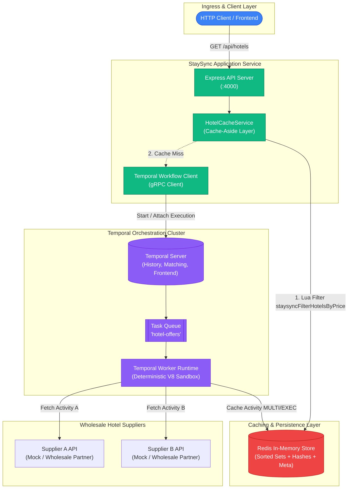
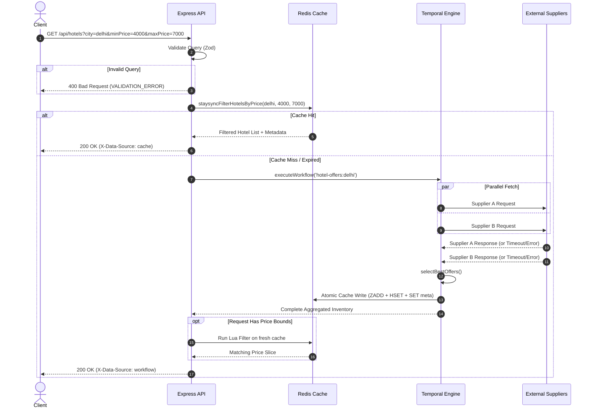
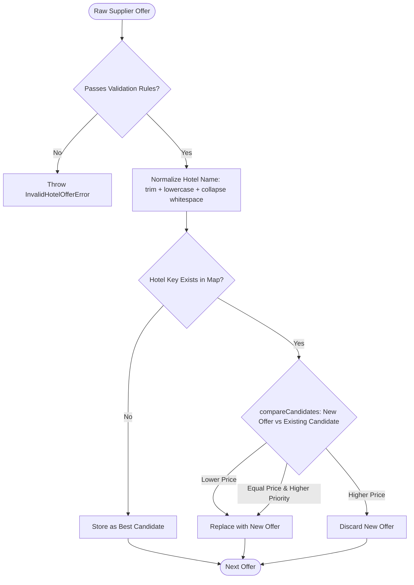
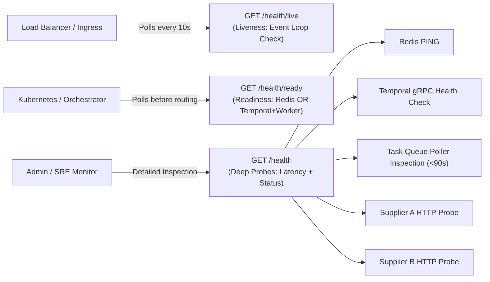
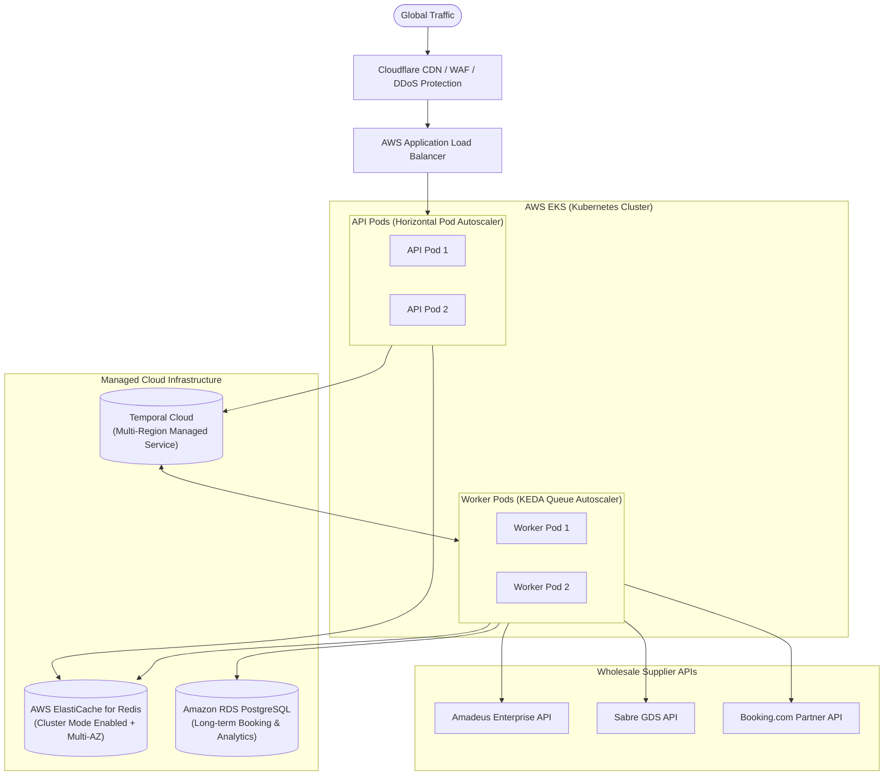

# StaySync — System Design Document

**Document Version:** 1.0.0  
**Target Architecture:** Distributed Hotel Offer Orchestration Platform  
**Authors:** StaySync Engineering Team  
**Live Production URL:** [https://staysync-ad96.onrender.com](https://staysync-ad96.onrender.com)

---

## 1. System Overview

StaySync is a distributed hotel offer aggregator designed to coordinate asynchronous inventory retrieval across multiple wholesale travel suppliers, normalize and deduplicate overlapping room offers, resolve the lowest consumer rate, and serve price-filtered queries from an in-memory Redis cache with low latency.

The system replaces traditional ad-hoc asynchronous orchestrations with **Temporal**, ensuring durable execution, deterministic replays, automatic backoff retries, and clean degradation under partial supplier failure.

---

## 2. Functional Requirements

1. **Multi-Supplier Ingestion**: Asynchronously retrieve hotel offers for a target city from Supplier A and Supplier B concurrently.
2. **Deterministic Deduplication**: Match identical hotel entities across suppliers regardless of casing, leading/trailing whitespace, or internal redundant whitespace.
3. **Cheapest Rate Selection**: Select the single lowest price for any duplicate listing. If rates are identical, apply a deterministic tie-breaking policy prioritizing Supplier A.
4. **Sorted Inventory Delivery**: Deliver aggregated hotel offers sorted in ascending order by price.
5. **In-Memory Caching**: Persist deduplicated city inventories in Redis with appropriate Time-To-Live (TTL) values.
6. **Server-Side Price Range Filtering**: Allow consumers to query hotels filtered by `minPrice` and `maxPrice`. Execute filtering directly within Redis to eliminate server-side memory overhead.
7. **Fault-Tolerant Partial Degradation**: If one supplier is unavailable, return remaining offers marked with `degraded: true` and a shorter cache TTL. If all suppliers fail, fail fast with `502 Bad Gateway`.
8. **Comprehensive Observability**: Expose granular health endpoints reporting the status and latency of every dependency.

---

## 3. Non-Functional Requirements

- **Low Latency**: Cache hits must be served in `< 10ms`. Price range filters must be evaluated inside Redis via compiled Lua scripts (`EVALSHA`) to avoid unneeded payload transfers.
- **Durable Orchestration**: Upstream supplier timeouts or network glitches must not leave the system in an inconsistent state. Long-running or retried tasks are managed by Temporal's persistent state machine.
- **Strict Idempotency**: Multiple concurrent requests for an uncached city must attach to a single running workflow execution rather than duplicating upstream network traffic.
- **Determinism**: Workflow logic must be completely pure, free of I/O, randomness, system clocks, or locale-specific string comparisons, guaranteeing flawless replayability.
- **Resource Efficiency**: Able to operate reliably within constrained container environments (e.g. 512 MB RAM on free cloud tiers) while remaining horizontally scalable.

---

## 4. High-Level Architecture



---

## 5. Component Responsibilities

| Component            | Key Module(s)                     | Primary Responsibility                                                                                         |
| -------------------- | --------------------------------- | -------------------------------------------------------------------------------------------------------------- |
| **API Server**       | `src/server.ts`, `src/app.ts`     | Listens for HTTP traffic, parses JSON, handles graceful shutdown signals (`SIGTERM`, `SIGINT`).                |
| **Validation Layer** | `src/validation/query.schemas.ts` | Validates query parameters (`city`, `minPrice`, `maxPrice`) using Zod schemas before touching any backend.     |
| **Search Service**   | `src/services/hotel.service.ts`   | Orchestrates the cache-aside strategy: attempts Redis read; on miss, triggers Temporal workflow.               |
| **Cache Service**    | `src/services/redis.service.ts`   | Manages atomic multi-key Redis transactions (`MULTI/EXEC`) and executes pre-loaded Lua filtering scripts.      |
| **Workflow Engine**  | `src/workflows/hotel.workflow.ts` | Deterministic workflow orchestrator coordinating parallel supplier fetches, error handling, and cache updates. |
| **Activities**       | `src/activities/`                 | Encapsulates all side effects: supplier HTTP calls (with client-side timeouts) and Redis write activities.     |
| **Domain Logic**     | `src/domain/hotel-aggregation.ts` | Pure functions for string normalization, validation, candidate comparison, and deduplication.                  |
| **Health Service**   | `src/services/health.service.ts`  | Executes background health probes with a 2-second cache to prevent probe storms.                               |

---

## 6. Detailed Request Lifecycle



---

## 7. Temporal Workflow Architecture

### Determinism Rules

Temporal workflow functions execute inside a deterministic sandbox (V8 Isolates). To ensure replay safety:

- **Zero I/O**: Network requests, filesystem access, and Redis operations are delegated to Activities via `proxyActivities`.
- **Zero Environmental Non-Determinism**: Direct access to `process.env`, `Date.now()`, `Math.random()`, or system timers inside workflow code is forbidden.
- **Pure Imports Only**: Only pure domain models, constants, and types are imported into `hotel.workflow.ts`.

### Request Coalescing (Single-Flight Pattern)

Workflows are identified by a deterministic workflow ID:

```ts
export function hotelOfferWorkflowId(city: string): string {
  return `hotel-offers:${city}`;
}
```

Configured with:

```ts
workflowIdConflictPolicy: 'USE_EXISTING';
workflowIdReusePolicy: 'ALLOW_DUPLICATE';
```

When multiple clients query an uncached city simultaneously, only one workflow starts. All subsequent concurrent requests attach to the ongoing execution via `handle.result()`, completely eliminating redundant upstream traffic.

---

## 8. Supplier Integration Design

### Concurrency Model

Supplier activities are scheduled before awaiting:

```ts
const [settledA, settledB] = await Promise.allSettled([
  fetchSupplierAHotels({ city }),
  fetchSupplierBHotels({ city }),
]);
```

`Promise.allSettled` ensures an unhandled rejection from one supplier does not abort the other.

### Timeout Hierarchy

```text
Temporal Workflow Timeout: 30,000ms
├── Supplier Activity ScheduleToClose: 15,000ms
│   ├── Attempt 1 StartToClose: 5,000ms (HTTP client timeout: 3,000ms)
│   ├── Backoff: 500ms
│   ├── Attempt 2 StartToClose: 5,000ms (HTTP client timeout: 3,000ms)
│   └── Backoff: 1,000ms
└── Cache Activity ScheduleToClose: 10,000ms
    ├── Attempt 1 StartToClose: 5,000ms
    └── Retry Backoff: 300ms
```

---

## 9. Deduplication Algorithm

The deduplication algorithm (`selectBestOffers`) processes supplier inventories in `O(N)` time and `O(U)` auxiliary memory (where `N` is total offers and `U` is unique hotels):



### Normalization Logic

```ts
export function normalizeHotelName(name: string): string {
  return name.trim().replace(/\s+/g, ' ').toLowerCase();
}
```

Ensures `"The Oberoi"`, `" the  oberoi "`, and `"THE OBEROI"` resolve to the identical key `"the oberoi"`.

---

## 10. Cheapest-Offer Selection

When multiple valid offers match a normalized key, a strict total ordering is enforced by `compareCandidates`:

```ts
function compareCandidates(a: Candidate, b: Candidate): number {
  return (
    a.offer.price - b.offer.price ||
    a.priority - b.priority ||
    compareStrings(a.offer.hotelId, b.offer.hotelId) ||
    compareStrings(a.offer.name, b.offer.name) ||
    a.offer.commissionPct - b.offer.commissionPct
  );
}
```

1. **Price (Primary)**: Lowest numerical room rate wins.
2. **Supplier Priority (Secondary Tie-Breaker)**: Supplier A (`priority = 0`) takes precedence over Supplier B (`priority = 1`).
3. **Deterministic Field Comparison (Tertiary)**: If a single supplier returns multiple offers for the same hotel at the same price, `hotelId`, `name`, and `commissionPct` are compared using binary code-point ordering (`compareStrings`), ensuring outputs remain invariant under array shuffling.

---

## 11. Redis Data Model & Cache Strategy

### 3-Key Storage Pattern

```text
staysync:hotels:{city}        (Sorted Set)  --> [Score: Price]  [Member: Normalized Name]
staysync:hotels:{city}:data   (Hash)        --> [Field: Name]   [Value: JSON Offer Payload]
staysync:hotels:{city}:meta   (String)      --> JSON Metadata (count, degraded, refreshedAt, ttl)
```

### Atomic Refresh Transaction

Cache writes are issued via a single Redis pipeline (`MULTI/EXEC`):

```text
DEL    staysync:hotels:{city} staysync:hotels:{city}:data staysync:hotels:{city}:meta
ZADD   staysync:hotels:{city} <price_1> <name_1> <price_2> <name_2> ...
HSET   staysync:hotels:{city}:data <name_1> <json_1> <name_2> <json_2> ...
EXPIRE staysync:hotels:{city} <ttl>
EXPIRE staysync:hotels:{city}:data <ttl>
SET    staysync:hotels:{city}:meta <metadata_json> EX <ttl>
EXEC
```

Readers either observe the complete previous entry or the complete fresh entry, preventing stale reads.

### In-Redis Lua Filtering Script

Executed via `EVALSHA`:

- Verifies existence of `metaKey`.
- Confirms `ZCARD` equals `meta.count`.
- Queries matching members using `ZRANGE zsetKey min max BYSCORE`.
- Batches `HMGET` in slices of 500 members to respect Lua stack limitations.
- Returns `{ metaJson, offerJson1, offerJson2, ... }`.

---

## 12. Error Handling & Retry Behavior

| Fault Scenario                     | Internal Reaction                                       | Client HTTP Response                                    |
| ---------------------------------- | ------------------------------------------------------- | ------------------------------------------------------- |
| **Invalid Query String**           | Caught by Zod validator in controller                   | `400 Bad Request` (`VALIDATION_ERROR`)                  |
| **Supplier A 500 / Timeout**       | Activity retries 3x; isolates failure; uses Supplier B  | `200 OK` (`X-Degraded: true`, 30s TTL)                  |
| **Both Suppliers Fail**            | Workflow raises non-retryable `AllSuppliersUnavailable` | `502 Bad Gateway` (`SUPPLIERS_UNAVAILABLE`)             |
| **Redis Down (Unfiltered Search)** | Catches error; falls back to live Temporal workflow     | `200 OK` (`X-Data-Source: workflow`, `X-Cached: false`) |
| **Redis Down (Filtered Search)**   | Fails fast (refuses to filter in JavaScript)            | `503 Service Unavailable` (`DEPENDENCY_UNAVAILABLE`)    |
| **Temporal Cluster Unreachable**   | gRPC connection timeout trips after 5s deadline         | `503 Service Unavailable` (`DEPENDENCY_UNAVAILABLE`)    |
| **Worker Down / Starved**          | Workflow times out after 30s execution deadline         | `504 Gateway Timeout` (`WORKFLOW_TIMEOUT`)              |

---

## 13. Health Checks & Probing Architecture

StaySync provides a 3-tier health check architecture:



- **Poller Freshness Window**: A Temporal worker is considered healthy only if `describeTaskQueue` reports an active poller whose last access occurred within `90,000ms`.
- **Probe Caching**: Probe results are cached for 2,000ms to prevent health endpoints from causing denial-of-service on upstream dependencies.

---

## 14. Security Considerations

1. **Least Privilege**: The Docker container runs as the unprivileged `USER node` (UID 1000). Application files are owned by `root` and mounted read-only.
2. **Encrypted In-Transit Traffic (TLS)**: Redis connections in production use encrypted TLS (`rediss://`) with ACL authentication (`username: "default"`).
3. **No Secret Leakage**: Passwords and connection secrets are injected exclusively through environment variables. `pino` loggers filter credentials from error stacks and URL strings.
4. **Input Sanitization**: `city` query parameters are strictly validated against a regex (`^[a-zA-Z0-9\s.'-]+$`) preventing command or Lua injection.
5. **No Dangerous Evaluation**: The Lua script is pre-loaded via `SCRIPT LOAD` (`ioredis.defineCommand`) and invoked exclusively via its SHA1 hash (`EVALSHA`).

---

## 15. Deployment Architecture

### Architecture Comparison

| Dimension              | Local Development                       | Render Free Demo Deployment                                   |
| ---------------------- | --------------------------------------- | ------------------------------------------------------------- |
| **Process Count**      | 4 isolated containers                   | 1 combined container                                          |
| **Supervisor**         | Docker Compose Engine                   | Bash process manager (`scripts/start-combined.sh`)            |
| **Temporal Server**    | Dockerized `temporalio/temporal:1.10.1` | Embedded headless Temporal binary (`/usr/local/bin/temporal`) |
| **Worker Process**     | Dedicated `worker` container            | Background process inside container                           |
| **Redis**              | Dedicated `redis:7.4-alpine`            | External **Upstash Redis** over TLS                           |
| **Inter-Process Comm** | Docker bridge network DNS               | Loopback interface (`127.0.0.1:7233`, `127.0.0.1:${PORT}`)    |

---

## 16. Scalability Considerations

- **Read Scalability**: The read path is dominated by Redis Lua queries (`O(log N + M)` where `M` is matching items). Scaling read throughput requires provisioning Redis Read Replicas.
- **Write Scalability**: Cache writes occur once per cache miss (`O(N)`). Workflows are coalesced per city, bounding write concurrency to the number of distinct cities queried.
- **Worker Auto-Scaling**: Temporal workers are stateless. In a production cluster, worker pods scale horizontally based on the `ApproximateBacklogCount` metric reported by Temporal's `describeTaskQueue`.

---

## 17. Failure Scenarios and Trade-Offs

### Consistency vs. Availability (CAP Theorem)

StaySync prioritizes **Availability** over strict consistency:

- When a supplier fails, degraded inventory is returned immediately rather than failing the search.
- When Redis is unreachable, unfiltered queries bypass the cache and run directly against Temporal, maintaining service availability.
- When price filtering is required and Redis is down, the system sacrifices availability (`503`) to guarantee accuracy, refusing to perform unindexed in-memory filtering.

---

## 18. Current Limitations

1. **Free-Tier Sleep**: Hosted on Render Free Web Service, which idles after 15 minutes of inactivity. First wake-up entails a ~45–60s cold start.
2. **Ephemeral Temporal DB**: The embedded Temporal dev server writes to `/tmp/temporal.db`. Restarts reset workflow execution history (Upstash cache data persists).
3. **Memory Proximity**: The combined container consumes ~420–480 MB RSS, operating near Render's 512 MB memory threshold.
4. **Mock Upstream Partners**: Upstream suppliers are currently simulated via Express sub-routers rather than live third-party GDS/OTA connections.

---

## 19. Future Production Architecture



- **Temporal Cloud**: Eliminates local dev server constraints and provides cross-region high availability.
- **Redis Cluster Mode**: Enables hash-slot sharding across memory nodes for multi-gigabyte hotel caches.
- **KEDA Autoscaling**: Automatically scales worker container replicas based on real-time task queue depth.
